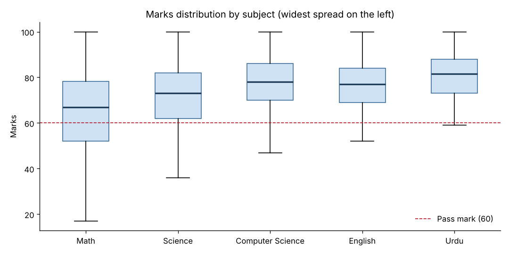
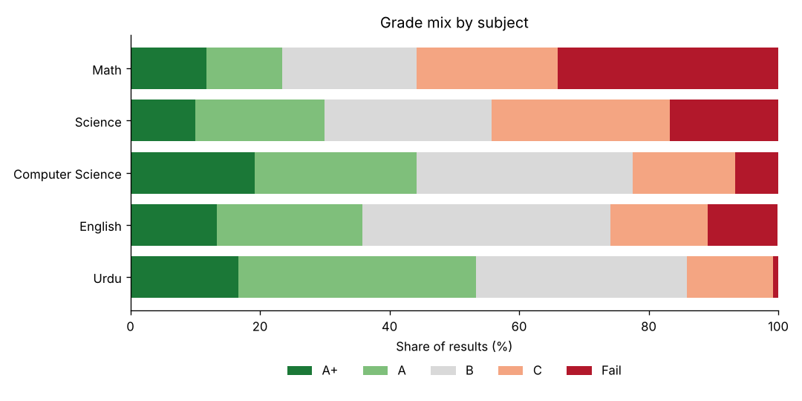
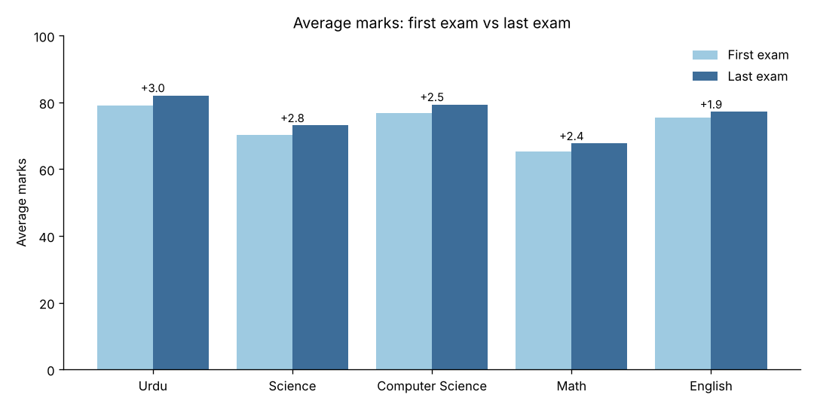

# Student Marks Analysis

Analysis of student exam results that finds which subjects have the widest spread of marks, shows how grades are distributed in each subject, and measures how results changed between the midterm and the final exam.

**Live demo:** LIVE_DEMO_URL



## Problem

A results sheet shows marks but does not show where students are struggling. A subject can have a reasonable average and still have a large group of students failing it. This project answers four questions:

1. Which subject has the widest gap between strong and weak students?
2. What share of each grade does each subject produce?
3. Did students improve between the first and the last exam, and in which subjects?
4. Which students need support in more than one subject?

## Dataset

`data/student_marks.csv` holds 600 records: 60 students, 5 subjects (Math, English, Science, Computer Science, Urdu) and 2 exams (Midterm and Final).

| Column | Description |
|---|---|
| student_id | Student identifier, for example S001 |
| subject | Subject name |
| exam | Exam name |
| exam_date | Date of the exam (YYYY-MM-DD) |
| marks | Marks out of 100 |

The data is synthetic. It is created by `scripts/generate_data.py` with a fixed random seed, so the results can be reproduced. You can analyze your own data by uploading a CSV with the same columns in the app.

## Approach

1. Load the CSV, check for missing values and duplicates, and validate the required columns.
2. Assign a grade to each result: A+ 90 and above, A 80 to 89, B 70 to 79, C 60 to 69, Fail below 60.
3. Measure spread per subject with standard deviation, interquartile range and range, along with average and pass rate.
4. Compare each student's first and last exam in every subject.
5. Rank students by their average in the final exam and count failed subjects.

## Results

| Subject | Average | Std dev | IQR | Lowest | Highest | Pass rate |
|---|---|---|---|---|---|---|
| Math | 66.5 | 18.7 | 26.2 | 17 | 100 | 65.8% |
| Science | 71.7 | 13.7 | 20.0 | 36 | 100 | 83.3% |
| Computer Science | 78.1 | 12.1 | 16.0 | 47 | 100 | 93.3% |
| English | 76.3 | 11.3 | 15.0 | 52 | 100 | 89.2% |
| Urdu | 80.6 | 10.0 | 15.0 | 59 | 100 | 99.2% |

- Math has the widest spread and the lowest pass rate. About a third of Math results are below 60.
- Urdu is the most consistent subject, with almost every student passing.
- All five subjects improved from midterm to final, by 1.9 to 3.0 marks on average. 56 of 60 students improved overall.
- 8 students failed two or more subjects in the final exam.

Since the Math average is not far below the others, but its spread is much wider, extra support should be aimed at the lower half of the class rather than at the whole class.





## Web app

The Streamlit app runs the same analysis on the sample data or on an uploaded CSV. It includes:

- Summary metrics: number of students, average marks, pass rate and the subject with the widest spread
- Filters for subjects and exams
- Box plot, histogram and spread table per subject
- Grade mix chart
- Exam comparison chart and table
- Student ranking
- CSV downloads for the summary and the exam comparison

## Tech stack

Python, Pandas, NumPy, Matplotlib, Streamlit, Jupyter Notebook

## Project structure

```
student-marks-analysis/
├── app.py                          Streamlit app
├── data/
│   └── student_marks.csv           Sample dataset
├── notebooks/
│   └── student_marks_analysis.ipynb  Full analysis with charts and findings
├── reports/
│   ├── figures/                    Charts exported by the notebook
│   ├── subject_summary.csv
│   ├── exam_comparison.csv
│   └── student_ranking.csv
├── scripts/
│   └── generate_data.py            Creates the sample dataset
├── src/
│   └── analysis.py                 Analysis and chart functions used by the notebook and the app
├── requirements.txt
└── README.md
```

## Run locally

```bash
git clone https://github.com/Qasim00760/student-marks-analysis.git
cd student-marks-analysis
pip install -r requirements.txt
streamlit run app.py
```

To run the notebook:

```bash
pip install notebook
jupyter notebook notebooks/student_marks_analysis.ipynb
```

To regenerate the sample dataset:

```bash
python scripts/generate_data.py
```

## Author

Muhammad Qasim
[Portfolio](https://qasim.devsil.com) | [LinkedIn](https://www.linkedin.com/in/muhammad-qasim-1944b8349) | [GitHub](https://github.com/Qasim00760)
